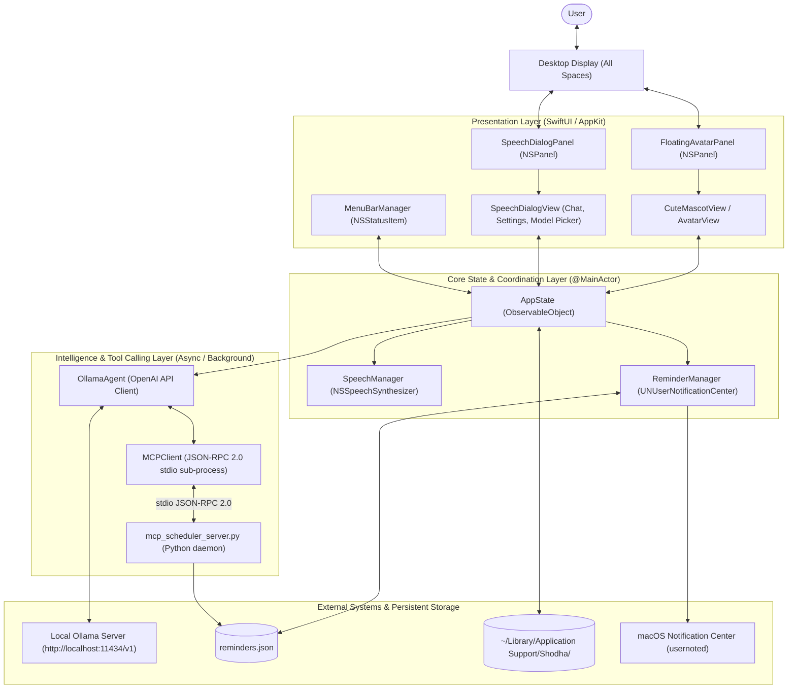

# Shodha System Architecture 🏛️

This document details the engineering design, system components, threading model, and data communication pipelines of **Shodha** (Mac desktop companion).

---

## 1. High-Level Architectural Diagram



---

## 2. Component Breakdown

### 2.1 Presentation Layer (`Sources/Windows/` & `Sources/Views/`)
- **`FloatingAvatarPanel`**:
  - Implemented as a borderless `NSPanel` with style mask `[.nonactivatingPanel]`.
  - Level set to `NSWindow.Level.floating` with collection behavior `[.canJoinAllSpaces, .fullScreenAuxiliary]`, ensuring it remains visible across all virtual desktop spaces and full-screen apps without intercepting global system key combinations.
  - Custom mouse-tracking handles interactive dragging while persisting screen coordinates (`Shodha.avatarPosX`, `Shodha.avatarPosY`) to `UserDefaults`.
- **`SpeechDialogPanel`**:
  - Anchors dynamically alongside the avatar's current location.
  - Implements auto-hiding behavior using `NotificationCenter` observing `NSApplication.didResignActiveNotification` and custom outside-click monitors.
- **`CuteMascotView` & `AvatarView`**:
  - Procedural vector rendering engine with periodic eye blink timers, glowing radial gradients, and animated mouth waveforms driven by the audio playback state.
  - Supports rendering custom user photos loaded dynamically from `~/Library/Application Support/Shodha/current_avatar.png`.

---

### 2.2 Core State Layer (`Sources/State/`)
- **`AppState` (`@MainActor ObservableObject`)**:
  - Serves as the single source of truth for the entire application.
  - Coordinates speech playback, dialog visibility, model selections, avatar customization, and settings persistence.
  - Automatically migrates legacy configuration from `EchoBuddy` to `Shodha` on startup if present.
- **`SpeechManager`**:
  - Wraps `NSSpeechSynthesizer` with delegate callbacks (`didFinishSpeaking`).
  - Manages pitch modulation presets (Cute, Normal, Deep, Chipmunk) and rate throttling.
- **`ReminderManager` (`UNUserNotificationCenterDelegate`)**:
  - Operates a high-precision 1-second timer loop checking `reminders.json`.
  - Dispatches native notifications via `UNUserNotificationCenter` with `UNNotificationCategory(options: [.hiddenPreviewsShowTitle, .hiddenPreviewsShowSubtitle])`.
  - Logs notification authorization diagnostics (`auth`, `alertSetting`, `alertStyle`) to `notify.log`.

---

### 2.3 Intelligence & Tool Execution Layer (`Sources/State/`)
- **`OllamaAgent`**:
  - Communicates with `/v1/chat/completions` and `/v1/models`.
  - Injects system prompts instructing the model to use tools for task execution.
  - Converts Model Context Protocol (MCP) tool schemas into standard OpenAI `tools` function definitions.
  - Handles the iterative tool-call lifecycle:
    1. Sends user message + tool schemas to Ollama.
    2. Receives `tool_calls` request.
    3. Dispatches tool invocation to `MCPClient`.
    4. Feeds tool result back as role `tool` to Ollama.
    5. Returns the model's final conversational answer to the UI.
- **`MCPClient`**:
  - Manages a persistent child process running Python (`Resources/mcp_scheduler_server.py`) communicating over standard input/output (`stdin`/`stdout`).
  - Implements the Model Context Protocol (MCP) handshake: `initialize`, `notifications/initialized`, and `tools/list`.
  - Executes tool calls via JSON-RPC 2.0 `tools/call`.
- **`mcp_scheduler_server.py`**:
  - Standalone MCP server exposing `schedule_reminder`, `list_reminders`, and `cancel_reminder`.
  - Evaluates relative and absolute time phrases (e.g. "in 15 minutes", "tomorrow at 9am") and atomic JSON persistence to `reminders.json`.

---

## 3. Communication Protocols

### 3.1 Model Context Protocol (MCP) over Stdio
```
  [ Shodha (MCPClient) ]                       [ Python MCP Server ]
            |                                            |
            | ---------- initialize (id: 1) -----------> |
            | <--------- initialize response ----------- |
            |                                            |
            | ---- notifications/initialized ----------> |
            |                                            |
            | ---------- tools/list (id: 2) -----------> |
            | <--------- tools list [schedule...] ------ |
            |                                            |
            | -- tools/call "schedule_reminder" (id: 3)->|
            |                                            | (writes reminders.json)
            | <--------- result: {scheduled: true} ----- |
```

### 3.2 Notification Delivery Architecture
```
  [ mcp_scheduler_server ] 
             | writes target_epoch
             v
     [ reminders.json ]
             ^
             | reads every 1.0s
  [ ReminderManager ]
             |
             | target_epoch <= now
             v
  [ UNUserNotificationCenter.add(request) ]
             |
             v
      [ macOS usernoted ]
             |
             v
   [ Notification Banner on Display ]
     - Title: "⏰ <Reminder Text>"
     - Subtitle: "Shodha Reminder"
     - Icon: Shodha AppIcon (synced with active avatar)
```

---

## 4. Security & Privacy Guarantees

1. **Local-First Execution:** By default, all inferences are routed to `localhost:11434`. No prompt data, reminders, or user photos are transmitted over the internet.
2. **Ad-Hoc Code Signing:** Shodha is signed with ad-hoc certificates during the build step (`codesign -s -`) to ensure secure LaunchServices registration without requiring paid Apple Developer certificates for local installation.
3. **Sandbox Compliance:** Data is cleanly organized in `~/Library/Application Support/Shodha/` using standard POSIX access controls.
